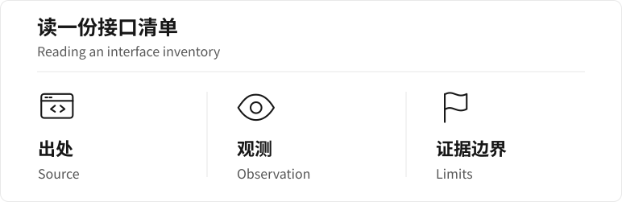

# bfs-clicker

[简体中文](README.md) · [English](README.en.md)

An interface inventory for web consoles and mobile apps. Each entry keeps its origin so developers can compare what a package declares with what a session actually recorded.

Start with the [mobile record schema](apk_tools/schemas/endpoint-record.schema.json) and the [gateway’s inventory notes](gateway/README.md). A static candidate was found in a package; a session observation applies only to the recorded run.
