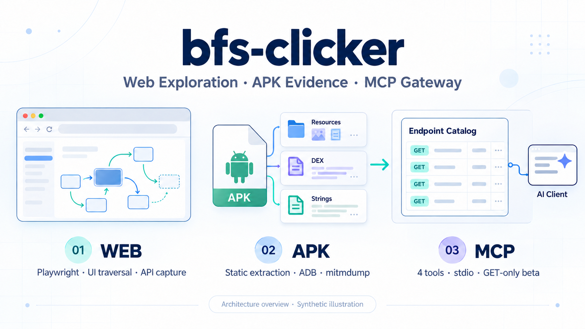
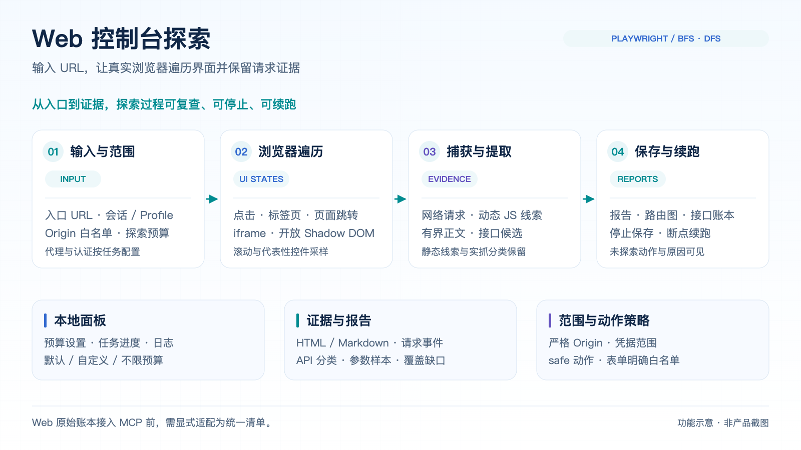
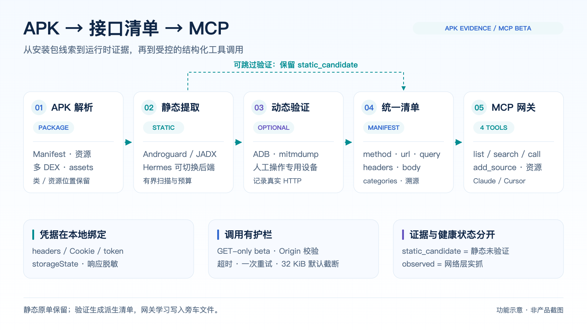

# bfs-clicker

**用真实浏览器探索 Web 控制台，从 Android APK 提取接口证据，再将统一清单接入 MCP 客户端。**

Playwright Web 界面遍历与动态 JS/API 捕获 · Android APK 静态分析与受控黑盒验证 · TypeScript MCP 网关。



[Web 使用指南](docs/web-guide.md) · [APK 提取与验证](apk_tools/README.md) · [MCP 配置](gateway/README.md) · [架构](docs/apk-mcp-architecture.md) · [验收与限制](docs/apk-mcp-verification.md) · [English](#english)

## 能做什么

| 模块 | 输入 | 主要能力 | 输出 |
| --- | --- | --- | --- |
| **Web 控制台探索** | URL、可选登录态与范围配置 | Playwright 真实点击，BFS/DFS、页面跳转、iframe/开放 Shadow DOM、停止与续跑 | 状态与路由图、动作证据、JS 中的接口候选、网络请求、HTML/Markdown 报告 |
| **Android APK 接口提取** | APK 文件 | Manifest/资源、多 DEX、assets、Retrofit 注解；按需 JADX 与可切换 Hermes 后端 | 统一接口清单、host 汇总、代码/资源位置、提取限制 |
| **受控动态验证** | APK、专用设备或模拟器、采集范围 | ADB 编排、mitmdump 实抓、人工操作 App、静态与动态证据合并 | `observed` 派生清单、参数形态、命中率与恢复报告 |
| **接口清单 → MCP** | Web 规范化清单或 APK 产出目录、本地凭据配置 | 固定 4 个工具、分页与搜索、只读资源、运行时热加载、受控 HTTP 调用 | 供 Claude Desktop / Cursor 使用的结构化响应 |

当前公开主线的 Android 流程使用 **ADB + mitmdump**。旧开发线的 Frida hook、Activity 跳转脚本尚未整合到当前主线；本页图片与命令对应已发布模块。

## 三条使用路径

### 1. 探索 Web 控制台



要求 **Node.js ≥20**。Web 爬虫和本地面板无需 Python。

```bash
git clone https://github.com/8eeth0ven/bfs-clicker.git
cd bfs-clicker
npm ci
npx playwright install chromium
npm run doctor
npm run view
```

打开终端显示的 [本地面板](http://127.0.0.1:4177/)，输入 URL 并选择探索预算。也可以使用 CLI：

```bash
# 默认预算探索
npm run run -- --asset https://console.example.com/ --output output-example

# 查看本地自建演示
npm run demo

# 从断点继续；取消六项探索预算
npm run resume -- --run output-example --unlimited
```

`example.com` 是占位地址。默认匿名、safe 动作、严格 origin 范围；已有会话、手动登录、代理与表单白名单见 [Web 使用指南](docs/web-guide.md)。面板支持预算设置、实时进度、停止保存和按新预算续跑。

动态 JS 正文与响应提取受体量预算约束；未知长度或超大响应会仅记元数据。`completed` 表示当前策略下发现队列耗尽，报告会保留未执行动作与覆盖缺口。

### 2. 从 APK 提取并验证接口



提取要求 **Python ≥3.11**；动态验证 extra 要求 **Python ≥3.12**，并安装 Android platform-tools。Hermes/JADX 为可选外部工具。

```bash
python3 -m venv .venv
.venv/bin/python -m pip install -e './apk_tools[verify]'
source .venv/bin/activate

# 先生成静态候选；demo.apk 替换为自己的测试包
apk_extract demo.apk --out output-mobile/demo

# 可选：在专用模拟器上实抓，期间人工操作 App
apk_verify demo.apk --inventory output-mobile/demo \
  --duration 5m --proxy 8080 --device emulator-5554 \
  --scope scope.local.yaml --isolated-device
```

`scope.local.yaml` 示例：

```yaml
origins:
  - https://api.example.test
```

- Androguard/资源解析器提供结构化证据，deep 模式按需调用 JADX。
- Hermes 先探测版本，再选择兼容后端；缺少工具时降级为有界字符串扫描。
- 静态候选标记为 `static_candidate`；实际 HTTP 观察标记为 `observed`，保留方法与参数形态。
- 未命中候选保持原分类，静态原单保留；设备代理与本轮 reverse 映射在退出时恢复。

HTTPS 可见性依赖 App 的 CA 信任、pinning 和代理行为；混淆、字符串加密、加固包、JNI/Flutter AOT 会降低提取率。配置、设备准备、HAR 导入与真实 fixture 说明见 [APK 工具指南](apk_tools/README.md)。

### 3. 把接口清单交给 AI 客户端

要求 **Node.js ≥22**。网关使用 `@modelcontextprotocol/sdk` 和 **stdio**，数百个端点共用固定 4 个元工具：

| 工具 | 用途 |
| --- | --- |
| `list_endpoints` | 按来源、路径、方法、分类浏览端点，支持分页与参数 schema |
| `search_endpoints` | 跨来源搜索路径、描述、参数名和提取位置 |
| `call_endpoint` | 按稳定 ID 填充路径/query/body，自动注入来源凭据并返回结构化响应 |
| `add_source` | 热加载可信配置绑定的清单文件或 APK 目录 |

每个来源还提供 `inventory://sources/<source>/manifest.json` 只读 resource。相同路径的不同方法归为一个条目，调用与学习状态按方法区分。

```bash
npm --prefix gateway ci
npm run gateway:build

# 查看三来源样例；真实使用时复制并修改本地配置
node gateway/dist/server.js --config gateway/examples/gateway.yaml

# 为 Cursor 生成配置；--config 指向自己的网关配置
node gateway/examples/client-config.mjs --cursor --config /absolute/path/gateway.local.yaml
```

也可使用 [Claude Desktop 模板](gateway/examples/claude_desktop_config.json) 或 [Cursor 模板](gateway/examples/cursor.mcp.json)。绝对路径、凭据绑定、来源范围及调用示例见 [MCP 网关指南](gateway/README.md)。

网关接收基础字段 `method/url/headers/query/body/categories`。APK 目录可直接导入；当前 Web v2 的 `apis.json` 是证据账本，**需要先显式适配成统一清单**。仓库未提供从该账本一键转换到网关的适配器。

## 证据、凭据与调用边界

| 项目 | 当前行为 |
| --- | --- |
| 来源与质量 | 保留 `manifest/strings/hermes/dex/asset/network` 溯源；实抓来源与网关健康状态分开记录 |
| 凭据 | 每来源绑定本地 headers、Cookie、Bearer 或 storageState 配置；客户端响应脱敏 |
| 方法 | beta 默认只允许已知 GET；写方法必须由可信配置显式开启并逐端点列名 |
| 请求范围 | 检查已注册 origin/host 与凭据范围；拒绝重定向，不允许客户端临时传任意 URL/headers |
| 请求执行 | 总超时、单次重试、状态码与耗时元数据；响应默认截断到 32 KiB |
| 自学习 | 连续成功/404/410写旁车健康状态；不篡改原清单，也不把健康成功冒充实抓证据 |
| 本地材料 | 凭据、APK、原始抓包、会话与运行报告由忽略规则排除；发布只含源码、模板和合成夹具 |

Web 默认会拦截危险动作；涉及业务写入的 UI 与 API 需要各自的明确策略。GET 本身无法证明业务无副作用。截图和未知业务字段仍需检查后分享。

## 输出在哪里

| 路径 | 内容 |
| --- | --- |
| `output-runs/<runId>/` | Web 的报告、状态/路由、API 账本、事件与覆盖缺口 |
| `output-runs/<runId>/private/` | Web 私有配置、原始证据、认证材料与恢复断点 |
| `output-mobile/<name>/source.json` | APK 身份、类型及当前清单指针 |
| `output-mobile/<name>/endpoints.static.json` | 静态接口原单 |
| `output-mobile/<name>/evidence.jsonl` / `hosts_summary.json` | 提取位置、后端信息、host 与环境提示 |
| `output-mobile/<name>/verified/<session>/` | 实抓派生清单、覆盖率、验证与清理报告 |
| 网关配置的 `state_dir` | 端点健康旁车文件 |

## 仓库导航

```text
src/                         Playwright 探索、请求守卫、证据与报告
view/                        本地任务控制面板
demo/                        本机 Web 演示
apk_tools/                   Python APK 提取器与受控验证 CLI
  apk_inventory/             解析、Hermes 适配、mitmdump、验证合并
  examples/                  自建 Android demo 源码与设备验证脚本
gateway/                     TypeScript stdio MCP 网关
  examples/                  三来源清单、凭据模板与客户端配置
  tests/                     目录、调用层与真实 SDK stdio 测试
docs/                        使用指南、架构、验收与功能图
```

## 验证与已知限制

```bash
npm --prefix gateway run build
npm --prefix gateway test
PYTHONPATH=apk_tools .venv/bin/python -m unittest discover -s apk_tools/tests -v

# 自建 APK → 真代理 → 派生清单 → 真 MCP SDK；需要 Android SDK/JDK
node gateway/examples/apk-e2e.mjs --python /path/to/venv/bin/python
```

最近验收：**网关 30/30，Python 45/45**，Python 运行包含真实编译 APK 与 Hermes fixture，无 skip。自行运行时，未设置真实 fixture 的相关测试可能跳过；完整条件见 [验收记录](docs/apk-mcp-verification.md)。

当前公开 Web 基线的根 `package.json` 引用了 7 个未入库测试脚本，根 `npm test` 尚不能复现整仓回归。APK/MCP 的独立测试入口可用；[Web 历史验收](docs/implementation-status.md) 仅描述原开发环境。

Web 的闭合 Shadow DOM、canvas、WebSocket/WebRTC、worker 与无限控件组合需要额外适配。APK 的加固/混淆、动态签名、mTLS/设备证明及任意版本 Hermes 自动恢复未覆盖。仓库尚未声明 LICENSE。

图为功能/架构示意，不是产品截图；[图片源文件与生成说明](docs/images/README.md) 可用于后续维护。

## English

**bfs-clicker combines a Playwright Web console crawler, Android APK interface evidence extraction and controlled runtime capture, and a guarded TypeScript MCP gateway.**

- **Web:** traverse UI states and navigation paths with BFS/DFS; capture network evidence and bounded JavaScript endpoint candidates; stop, save and resume from the local panel or CLI.
- **Android:** inspect Manifest/resources/DEX/assets with Androguard, optional JADX and selectable Hermes backends; use ADB + mitmdump on a dedicated device for optional manual runtime verification.
- **MCP:** expose normalized Web manifests and APK inventories through four tools, read-only resources and stdio for Claude Desktop / Cursor. Credentials stay in local per-source bindings; calls default to GET-only with origin checks and bounded responses.

The current public branch contains the ADB/mitmdump pipeline. Legacy Frida hooks and Activity-jumping scripts have not been integrated into this branch. The Web v2 evidence ledger also requires an explicit normalization adapter before MCP import; that adapter is not included.

Start with the [Web guide](docs/web-guide.md), [APK CLI guide](apk_tools/README.md) or [MCP gateway guide](gateway/README.md). See the [architecture](docs/apk-mcp-architecture.md) and [verification record](docs/apk-mcp-verification.md) for tested fixtures and limits.
