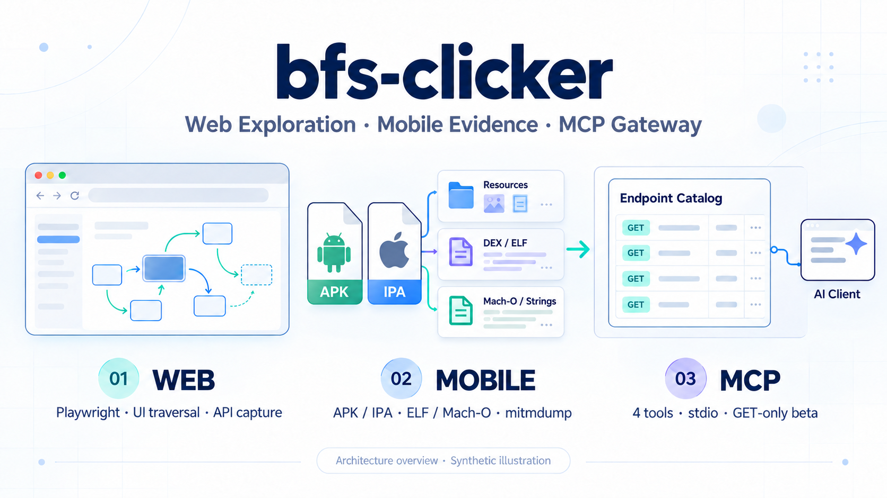
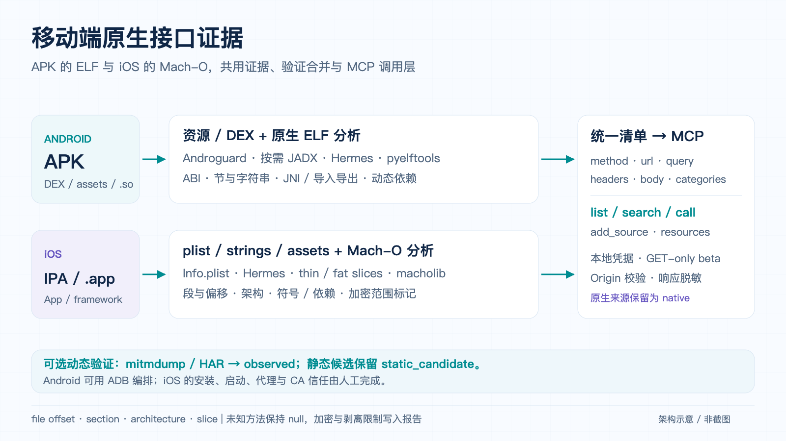

# bfs-clicker

**用真实浏览器探索 Web 控制台，从 Android APK 与 iOS IPA／App Bundle 提取接口证据，再将统一清单接入 MCP 客户端。**

Playwright Web 界面遍历与动态 JS/API 捕获 · Android / iOS 静态分析、原生二进制证据与受控黑盒验证 · TypeScript MCP 网关。



[一键准备](docs/capture-setup.md) · [Web 使用指南](docs/web-guide.md) · [APK 提取与验证](apk_tools/README.md) · [iOS 与原生层](docs/ios-native-guide.md) · [MCP 配置](gateway/README.md) · [架构](docs/apk-mcp-architecture.md) · [验收与限制](docs/apk-mcp-verification.md) · [English](#english)

## 从网站与 App 生成 MCP（整合分支）

本分支将 Web 探索、APK/iOS 清单、浏览器路径与移动 UI 后端接到统一能力目录：探索或导入 → 编译参数契约 → 调用验证 → 生成独立 MCP 入口 → 按 revision 更新。每个来源都会保留 ready/candidate、证据和覆盖缺口。

```bash
npm ci
npm --prefix gateway ci
npm --prefix gateway run build
npx playwright install chromium
node src/software-mcp.js --output-root ./output-software --artifact-root ./examples/software
```

统一入口要求 Node.js 22+；安装包分析另需 Python 环境。模型通过 `software_discover` 后台探索或提取，使用 `software_capabilities` 查参数与修订，`software_call` 调用能力，`software_generate` 生成含 server.mjs 和客户端配置的独立入口。原 Web 十二工具与公开接口网关仍可独立使用。

Android 使用 ADB 或已有 WebDriver session，iOS 接入已有 Appium/XCUITest session；设备来源在启动配置绑定。UI 能力包含已观察的固定路径和用不同输入验证的参数化流程，可返回文本、表格或类型化移动结果。查询候选可自动规划，创建、修改等写流程可从可信定义学习，执行和真实样本采样分别授权；原始单 APK 的 ADB 调用会核对安装字节。“任意网站与 App 都有完整 MCP 能力”仍是持续演进目标。详见 [统一入口与配置](docs/software-to-mcp.md) 和 [验证记录](docs/software-to-mcp-verification.md)。

控件覆盖包括原生 HTML 表单、具明确 ARIA 关系的懒挂载下拉，以及原生 App 的文本、布尔和完整单选组。Android RadioGroup / iOS SegmentedControl 可映射为有限 string enum；同值布尔或单选请求只复核状态。API 文档的查询编码和 URL 编码表单请求体随契约导入，支持 CSV、重复键、浅对象和 JSON 字段；条件字段按实际输入决定编码。已通过自建 Android 模拟器验证单选组完整调用链；iOS 已在真实 iOS 27.1 模拟器上完成自建 UIKit App 的自动候选、两样本学习、统一调用及独立 MCP 再调用；物理 iPhone 与任意第三方 App 仍需逐目标验证。

Canvas 页面可从可信流程定义接入本地 OCR：固定文字锚点定位、输入区回读、独立结果区断言及 `visualText` 提取。新版视觉合同比较解码后的画布像素，后续动作前重读已填输入，点击须落在识别锚点内；旧视觉合同需重新学习。示例与 `npm run demo:visual` 用法见 [视觉流程](docs/software-to-mcp.md#canvas-视觉流程)。当前支持可唯一定位的 Canvas 宿主，OCR 语言以本机安装模型为准；真实 Canvas 示例已通过统一入口与生成入口调用。可信配置可为单字段或显式关联的多字段视觉查询生成待样本验证的候选；每个字段仍需独立结果断言。复杂视觉流程仍需扩展。

同一结果验证阶段会复用同一个实际 Canvas 节点的截图和 OCR。双字段、双结果区域实测每个学习样本及执行的 OCR 次数从 15 次降至 10 次，查询参数与结果一致；这是当前源码开关缓存的对照，不能视为旧版整体性能或任意页面的加速比。复现见 [视觉性能记录](docs/software-to-mcp-verification.md#视觉识别开销)。

移动来源可按来源启用只读截图 OCR，使用 `software_observe_mobile` 获取带时间和坐标的视觉观察；生成入口在相同配置下提供 `observe_mobile`。详情见 [移动视觉观察](docs/software-to-mcp.md#移动视觉观察)。

Android 自绘界面的固定枚举、英文视觉文本替换，以及 iOS 固定枚举和无系统键盘的视觉文本替换，已在自建模拟器通过统一与生成 MCP 调用。当前编译器 `software-to-mcp-12` 新增可信同图 Vision ROI 和 iOS 普通软键盘的可选合同：ROI 保留整图与边界证据，按严格词界处理冲突；键盘合同区分实际 AX 框和本地批准的有限视觉区域，恢复完整界面后才提交。**Android 中文视觉文本已完成北京/上海两样本并发布 ready，但新参数调用仍失败；普通 UIKit 软键盘尚未完成两样本。两项均没有统一/生成双入口完整验收结论。** 已通过的中文 Web/Vision 与 Android Unicode 输入有各自范围。配置见 [Android 原生视觉动作](docs/software-to-mcp.md#android-原生视觉动作)、[iOS 普通系统软键盘](docs/software-to-mcp.md#ios-普通系统软键盘)；当前状态和可运行测试见 [验证记录](docs/software-to-mcp-verification.md) 与 [公开验证摘要](docs/software-to-mcp-validation.json)。

iOS 混合控件已完成真实模拟器验收：文本、Switch 与 SegmentedControl 自动识别为三字段流程，生成入口同值控件零切换；非法枚举和域漂移在 UI 动作前拒绝。保留拉伸 Switch 点击未生效的失败证据，详见 [验证记录](docs/software-to-mcp-verification.md)。

Android 可选本地 Unicode 输入桥已在隔离模拟器通过中文、emoji、组合字符与字面 `%s` 验收。参数化 MCP 流程完成四次替换查询；追加另由生产原生后端完成四次，尚未发布为 MCP 追加流程。默认 ADB 仍为 ASCII；输入桥按安装哈希绑定，使用前须由设备管理者安装并选择。详见 [Unicode 输入](docs/software-to-mcp.md#android-unicode-输入)。

## 一条命令准备测试环境

```bash
./capture-setup.sh ./demo.apk --isolated-device
./capture-setup.sh ./demo.ipa --target ios --isolated-device
./capture-setup.sh /path/to/Demo.app --target macos --scope scope.local.yaml
```

macOS 可双击 `capture-setup.command`。首次自动准备依赖，并打开本地引导页：识别设备、安装可用应用、配置代理/测试 CA；按系统要求同意授权后自动自测、启动 App、计时采集和恢复。项目 CA 与设备记录后续复用；iOS 优先使用 Configurator，普通真机的首次描述文件/完整信任步骤由页面引导。[完整用法与平台边界](docs/capture-setup.md)

## 能做什么

| 模块 | 输入 | 主要能力 | 输出 |
| --- | --- | --- | --- |
| **Web 控制台探索** | URL、可选登录态与范围配置 | Playwright 真实点击，BFS/DFS、页面跳转、iframe/开放 Shadow DOM、停止与续跑 | 状态与路由图、动作证据、JS 中的接口候选、网络请求、HTML/Markdown 报告 |
| **Android APK 接口提取** | APK 文件 | Manifest/资源、多 DEX、assets、Retrofit 注解、原生 `.so` 的 ELF/符号/字符串证据；按需 JADX 与 Hermes 后端 | 统一接口清单、host 汇总、代码/资源位置、提取限制 |
| **iOS 接口提取** | IPA 或 `.app` | Info.plist、strings、assets、Hermes、Mach-O thin/fat、framework/dylib、加密状态 | 统一清单、bundle/产物指纹、段/偏移/架构证据 |
| **受控动态验证** | 移动端清单、测试会话、采集范围 | Android 用 ADB 编排；iOS 手动配置设备代理；共用 mitmdump/HAR 与证据合并 | `observed` 派生清单、参数形态、命中率与恢复报告 |
| **接口清单 → MCP** | Web 规范化清单或 APK/iOS 产出目录、本地凭据配置 | 固定 4 个工具、分页与搜索、只读资源、运行时热加载、受控 HTTP 调用 | 供 Claude Desktop / Cursor 使用的结构化响应 |

当前公开主线的 Android 流程使用 **ADB + mitmdump**。旧开发线的 Frida hook、Activity 跳转脚本尚未整合到当前主线；本页图片与命令对应已发布模块。

## 四条使用路径

### 1. 探索 Web 控制台


要求 **Node.js ≥20**。Web 爬虫和本地面板无需 Python。

```bash
git clone https://github.com/8eeth0ven/bfs-clicker.git
cd bfs-clicker
npm ci
npx playwright install chromium
npm run doctor
npm run view
```

打开终端显示的 [本地面板](http://127.0.0.1:4177/)，输入 URL 并选择探索预算。也可以使用 CLI：

```bash
# 默认预算探索
npm run run -- --asset https://console.example.com/ --output output-example

# 查看本地自建演示
npm run demo

# 从断点继续；取消六项探索预算
npm run resume -- --run output-example --unlimited
```

`example.com` 是占位地址。默认匿名、safe 动作、严格 origin 范围；已有会话、手动登录、代理与表单白名单见 [Web 使用指南](docs/web-guide.md)。面板支持预算设置、实时进度、停止保存和按新预算续跑。

动态 JS 正文与响应提取受体量预算约束；未知长度或超大响应会仅记元数据。`completed` 表示当前策略下发现队列耗尽，报告会保留未执行动作与覆盖缺口。

### 2. 从 APK 提取并验证接口


提取要求 **Python ≥3.11**；动态验证 extra 要求 **Python ≥3.12**，并安装 Android platform-tools。Hermes/JADX 为可选外部工具。

```bash
python3 -m venv .venv
.venv/bin/python -m pip install -e './apk_tools[verify]'
source .venv/bin/activate

# 先生成静态候选；demo.apk 替换为自己的测试包
apk_extract demo.apk --out output-mobile/demo

# 可选：在专用模拟器上实抓，期间人工操作 App
apk_verify demo.apk --inventory output-mobile/demo \
  --duration 5m --proxy 8080 --device emulator-5554 \
  --scope scope.local.yaml --isolated-device
```

`scope.local.yaml` 示例：

```yaml
origins:
  - https://api.example.test
```

- Androguard/资源解析器提供结构化证据，deep 模式按需调用 JADX。
- Hermes 先探测版本，再选择兼容后端；缺少工具时降级为有界字符串扫描。
- 静态候选标记为 `static_candidate`；实际 HTTP 观察标记为 `observed`，保留方法与参数形态。
- 未命中候选保持原分类，静态原单保留；设备代理与本轮 reverse 映射在退出时恢复。

HTTPS 可见性依赖 App 的 CA 信任、pinning 和代理行为；混淆、字符串加密、加固包、JNI/Flutter AOT 会降低提取率。配置、设备准备、HAR 导入与真实 fixture 说明见 [APK 工具指南](apk_tools/README.md)。

### 3. 分析 iOS 与 APK 的原生层



```bash
# IPA 或 .app：Info.plist / resources / assets / Mach-O
# 沿用上面的 Python 虚拟环境
ios_extract demo.ipa --out output-ios/demo
ios_extract /path/to/Demo.app --out output-ios/app

# 已采集 HAR：专用隔离会话才可归因为 observed
ios_verify demo.ipa --inventory output-ios/demo \
  --har capture.har --scope scope.local.yaml --isolated-device
```

`ios_extract` 支持多 App 显式选择、原子代际清单与敏感字段脱敏；`.app` 使用稳定树哈希，IPA 使用文件 SHA-256。默认分析 APK 中的 `.so`，以 `source=native` 保留 ABI、段、文件偏移、导入/导出与 JNI 符号线索。可用 `--no-native` 关闭原生阶段。

iOS 的 `ios_verify` 是底层 HAR/mitmdump 入口；通常使用 `capture-setup.sh` 自动准备应用、代理与 CA，系统要求的首次确认由引导页处理。加密区不解密，剥离符号或动态拼接的 URL 可能无法恢复；URL 字符串不自动推断为 GET。完整配置、可复现夹具和边界见 [iOS/原生层指南](docs/ios-native-guide.md)。

### 4. 把接口清单交给 AI 客户端

要求 **Node.js ≥22**。网关使用 `@modelcontextprotocol/sdk` 和 **stdio**，数百个端点共用固定 4 个元工具：

| 工具 | 用途 |
| --- | --- |
| `list_endpoints` | 按来源、路径、方法、分类浏览端点，支持分页与参数 schema |
| `search_endpoints` | 跨来源搜索路径、描述、参数名和提取位置 |
| `call_endpoint` | 按稳定 ID 填充路径/query/body，自动注入来源凭据并返回结构化响应 |
| `add_source` | 热加载可信配置绑定的清单文件或 APK/iOS 目录 |

每个来源还提供 `inventory://sources/<source>/manifest.json` 只读 resource。相同路径的不同方法归为一个条目，调用与学习状态按方法区分。

```bash
npm --prefix gateway ci
npm run gateway:build

# 查看三来源样例；真实使用时复制并修改本地配置
node gateway/dist/server.js --config gateway/examples/gateway.yaml

# 为 Cursor 生成配置；--config 指向自己的网关配置
node gateway/examples/client-config.mjs --cursor --config /absolute/path/gateway.local.yaml
```

也可使用 [Claude Desktop 模板](gateway/examples/claude_desktop_config.json) 或 [Cursor 模板](gateway/examples/cursor.mcp.json)。绝对路径、凭据绑定、来源范围及调用示例见 [MCP 网关指南](gateway/README.md)。

网关接收基础字段 `method/url/headers/query/body/categories`。APK/iOS 目录可直接导入；当前 Web v2 的 `apis.json` 是证据账本，需要先适配成统一清单。统一入口的 `software_discover` / `software_compile_web` 已自动调用 Web 适配器；手工连接四工具网关时，应使用适配后的清单。

## 证据、凭据与调用边界

| 项目 | 当前行为 |
| --- | --- |
| 来源与质量 | 保留 `manifest/strings/hermes/dex/asset/plist/native/network` 溯源；实抓来源与网关健康状态分开记录 |
| 凭据 | 每来源绑定本地 headers、Cookie、Bearer 或 storageState 配置；客户端响应脱敏 |
| 方法 | beta 默认只允许已知 GET；写方法必须由可信配置显式开启并逐端点列名 |
| 请求范围 | 检查已注册 origin/host 与凭据范围；拒绝重定向，不允许客户端临时传任意 URL/headers |
| 请求执行 | 总超时、单次重试、状态码与耗时元数据；响应默认截断到 32 KiB |
| 自学习 | 连续成功/404/410写旁车健康状态；不篡改原清单，也不把健康成功冒充实抓证据 |
| 本地材料 | 凭据、APK、原始抓包、会话与运行报告由忽略规则排除；发布只含源码、模板和合成夹具 |

Web 默认会拦截危险动作；涉及业务写入的 UI 与 API 需要各自的明确策略。GET 本身无法证明业务无副作用。截图和未知业务字段仍需检查后分享。

## 输出在哪里

| 路径 | 内容 |
| --- | --- |
| `output-runs/<runId>/` | Web 的报告、状态/路由、API 账本、事件与覆盖缺口 |
| `output-runs/<runId>/private/` | Web 私有配置、原始证据、认证材料与恢复断点 |
| `output-mobile/<name>/source.json` | APK 身份、类型及当前清单指针 |
| `output-mobile/<name>/endpoints.static.json` | 静态接口原单 |
| `output-mobile/<name>/evidence.jsonl` / `hosts_summary.json` | 提取位置、后端信息、host 与环境提示 |
| `output-ios/<name>/static/<generation>/` | iOS 静态原单、证据和提取报告；source.json 最后原子切换 |
| `output-mobile/<name>/native_libraries.json` | APK 原生库架构、节、符号、依赖与限制 |
| `output-mobile/<name>/verified/<session>/` | 实抓派生清单、覆盖率、验证与清理报告 |
| 网关配置的 `state_dir` | 端点健康旁车文件 |

## 仓库导航

```text
src/                         Playwright 探索、请求守卫、证据与报告
view/                        本地任务控制面板
demo/                        本机 Web 演示
apk_tools/                   Python APK/iOS 提取器、ELF/Mach-O 与受控验证 CLI
  apk_inventory/             解析、Hermes 适配、mitmdump、验证合并
  examples/                  自建 Android demo、iOS 静态夹具与设备验证脚本
gateway/                     TypeScript stdio MCP 网关
  examples/                  三来源清单、凭据模板与客户端配置
  tests/                     目录、调用层与真实 SDK stdio 测试
docs/                        使用指南、架构、验收与功能图
```

## 验证与已知限制

```bash
npm --prefix gateway run build
npm --prefix gateway test
PYTHONPATH=apk_tools .venv/bin/python -m unittest discover -s apk_tools/tests -v

# 自建 APK → 真代理 → 派生清单 → 真 MCP SDK；需要 Android SDK/JDK
node gateway/examples/apk-e2e.mjs --python /path/to/venv/bin/python
```

早期独立验收：网关 33/33、Python 178/178，包含真实 APK 与 Hermes fixture。整合分支的最新全套、专项及设备结果另见 [统一入口验证记录](docs/software-to-mcp-verification.md)；缺少外部 fixture 时会保留 skip。

历史公开 Web 基线曾引用未入库测试脚本；本整合分支已导入 Web 性能、流程图、浏览器 MCP 的源码与回归，并提供统一生成链路专项。`npm test`、`npm run test:software` 与移动适配器专项分别保留结果，具体记录见 [统一入口说明](docs/software-to-mcp.md)。

Web 的闭合 Shadow DOM、Canvas 自动业务规划、WebSocket/WebRTC、worker 与无限控件组合仍需扩展；固定可信 Canvas 视觉流程已支持。APK 的加固/混淆、动态签名、mTLS/设备证明及任意版本 Hermes 自动恢复未覆盖。仓库尚未声明 LICENSE。

iOS 真实代理 + MCP SDK 的本地夹具链可运行 `node gateway/examples/ios-e2e.mjs --python /path/to/venv/bin/python`。该示例没有操作 iOS 设备，未签名 Mach-O 对象仅用于静态证据，实际 HTTP 由 loopback 测试客户端产生。

首页架构图为功能示意；[一键准备指南](docs/capture-setup.md) 另含使用合成数据渲染的实际引导页截图。[图片源文件与生成说明](docs/images/README.md) 可用于后续维护。

## English

**bfs-clicker combines a Playwright Web console crawler, Android APK and iOS IPA/App Bundle interface evidence extraction, native ELF/Mach-O inspection and controlled runtime capture, and a guarded TypeScript MCP gateway.**

- **Web:** traverse UI states and navigation paths with BFS/DFS; capture network evidence and bounded JavaScript endpoint candidates; stop, save and resume from the local panel or CLI.
- **Android:** inspect Manifest/resources/DEX/assets and native `.so` ELF evidence, with optional JADX and selectable Hermes backends; use ADB + mitmdump for runtime capture.
- **iOS:** inspect plist/strings/assets and Mach-O binaries/frameworks in IPA or `.app` bundles. The unified `capture-setup.sh` prepares supported device/app/proxy/CA actions, guides mandatory system approvals, verifies a real HTTPS path, starts capture and restores owned settings. Encrypted ranges are reported rather than decrypted; native strings do not imply an HTTP method.
- **MCP:** expose normalized Web manifests and APK/iOS inventories through four tools, read-only resources and stdio for Claude Desktop / Cursor. Credentials stay in local per-source bindings; calls default to GET-only with origin checks and bounded responses.

The public branch contains the Android ADB/mitmdump pipeline and iOS manual-proxy/HAR verification. Legacy Frida hooks and Activity-jumping scripts have not been integrated into this branch. The unified software entry includes an adapter for the Web v2 evidence ledger; a standalone four-tool gateway still expects a normalized manifest. The generated entry uses the local runtime and private source bindings, and is not a portable package by itself.

Start with the [Web guide](docs/web-guide.md), [APK CLI guide](apk_tools/README.md) or [MCP gateway guide](gateway/README.md). See the [architecture](docs/apk-mcp-architecture.md) and [verification record](docs/apk-mcp-verification.md) for tested fixtures and limits.
