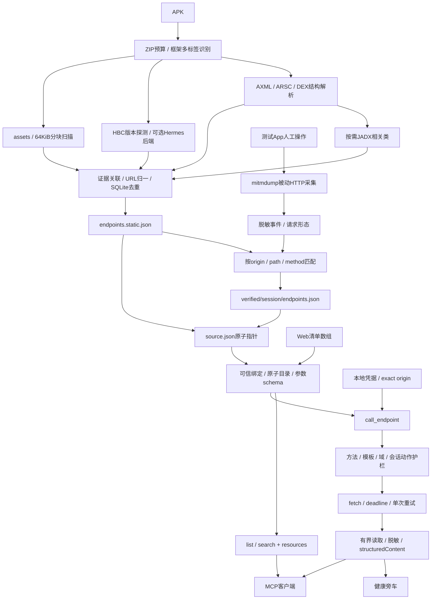

# APK / Web 清单到 MCP 的实现架构

## 数据流



## 模块边界

| 模块 | 输入 | 输出 / 责任 |
|---|---|---|
| Python extract | APK + ExtractOptions | source.json、六字段静态记录、证据、碎片、hosts汇总 |
| Python parsers | 受限单个AXML/ARSC/DEX成员 | 资源或方法关联，隔离worker预算 |
| Python hermes | HBC文件、版本、已安装工具配置 | 文本/字面量证据或明确降级 |
| Python verify/addon | App真实HTTP或事件/HAR导入 | 观察形态、覆盖率、原单不变的派生清单 |
| TS manifest/registry | 可信source绑定、清单文件/目录 | 稳定ID、逐方法schema、原子快照 |
| TS discovery | 快照+关键词/过滤/cursor | 摘要或完整参数schema，不展开工具列表 |
| TS credentials/executor | 选定operation+params | 自动凭据、护栏、结构化HTTP结果 |
| TS learning | 一次逻辑调用的最终观察 | 仅健康旁车，不改采集来源 |

Python CLI通过子进程/文件协议接入，stdout一行JSON，参数用argv数组；MCP add_source仅导入已产生的清单，不隐式启动设备或执行清单指定程序。

## 身份与证据

- 工具参数source是注册ID；记录source是manifest/strings/hermes/dex/asset/network渠道。
- Android包名在app.package_name；记录package是类/资源/偏移定位。
- group.id = ep_ + SHA256(JSON.stringify(["endpoint-v1",source_id,origin,path_template]))。
- 同path不同method共享group ID，参数/权限/来源/学习分别保存；不同origin分组。
- 未知method=null保持可发现、不可调用。方法只来自明确配置/注解/调用或实抓证据。
- 每条采集记录的static_candidate/observed分类互斥；聚合operation可同时携带多份来源证据。
- observed表示确实捕获HTTP请求；2xx、业务成功、可用fetch重放都是独立问题。

## 保守推导

路径只接受显式模板，不用数字形状猜路由。query重复键保留数组；单样例不能推required/enum/范围或自动默认值。多次body/query形态合并，不把类型字符串当样例。header认证值和样例不对客户端公开。可信schema校正可收紧RPC selector，但HTTP GET本身不证明任意业务语义只读。

## 凭据与请求

凭据YAML四个输入模式（token归一为header）共用provider。Secret值不写旁车、清单或客户端配置。已知认证值与常见转义、敏感字段在正文和所有公开出口处理；可信目录身份元数据与上游响应分开，避免lang=zh/flag=1污染source ID或哈希。

客户端不能覆盖URL、Host、Origin或认证头。目标实际origin必须在清单及来源限制内，发凭据还必须属于credential_origins；Host由网络库构造。所有重定向手动阻断。路径参数拒绝点路径、分隔符和重复解码越界。logout/revoke族包括CamelCase及query/body selector始终禁止。

整次deadline覆盖首请求、body和一次重试；只对GET暂态失败/502/503/504重试，写请求不自动重试。响应按解压后读取预算和UTF8返回预算有界处理，秘密跨截断边界用lookahead识别。完整JSON才返回对象；否则文本/二进制摘要。HTTP错误仍保留状态和耗时。

## 热加载与自学习

所有文件路径realpath检查；source.json中的inventory仅允许目录内相对引用，并可校验inventory_sha256。完整新目录和凭据验证成功后换快照。旧请求持有原快照；cursor继续原分页；expected_revision阻止按旧参数契约执行。

健康旁车按source/endpoint/method/contract记录：连续N个2xx为http_verified，连续N个404/410为not_found_suspected；其他网络结果中断连续性，本地拒绝不计。重试一次也只记一次。404可能表示对象不存在，状态不自动删路由。App实抓分类不会因网关学习被伪造。

## 开源复用与当前边界

主线复用pyaxmlparser、Androguard和按需JADX。Hermes通过后端适配，不自动下载工具或执行bundle。hbctool仅旧版，hermes-dec/官方hbcdump/hermes_rs各自依赖HBC版本。已用官方hermesc0.11.0只编译自建JS成HBC84，经hermes-dec0.1.7恢复字符串和请求配置；另验证公开HBC94解析。其余版本仍需独立fixture，不把fake CLI测试或版本表存在当兼容结论。

mitmdump是已实现采集器，HAR是已实现导入器。PCAPdroid的设备编排与UID关联、完整Flutter/JNI恢复、自动脱壳、动态签名、客户端证书/mTLS、二进制上传、WebSocket消息和gRPC字段恢复均未作为beta已完成能力。

GPL/AGPL可选工具按具体选定版本与分发方式记录许可证；子进程边界不自动免除发行义务。工具不随仓库自动打包，许可证参考各上游项目。

## 复验

```bash
npm --prefix gateway ci
npm --prefix gateway run build
npm --prefix gateway test
APK_INVENTORY_FIXTURE=/absolute/path/demo.apk \
  HBC_FIXTURE=/absolute/path/fixture.hbc \
  PYTHONPATH=apk_tools /path/to/venv/bin/python -m unittest discover -s apk_tools/tests -v
node gateway/examples/apk-e2e.mjs --python /path/to/venv/bin/python --apk /absolute/path/demo.apk
```

测试层分别验证：静态结构/大文件预算、真实mitmdump观察、真SDK stdio调用、fake设备恢复逻辑，以及独立模拟器的实际App网络采集。实际运行记录以e2e-report.json、verification_report.json和测试输出为准；源码说明不代替实测。

发布整合保留远端 v2 核心代码。其根 package.json 引用的 7 个测试脚本未随远端基线入库，因此根 npm test 不作为本次 APK/MCP 模块的通过依据，详见 [验收记录](apk-mcp-verification.md)。
