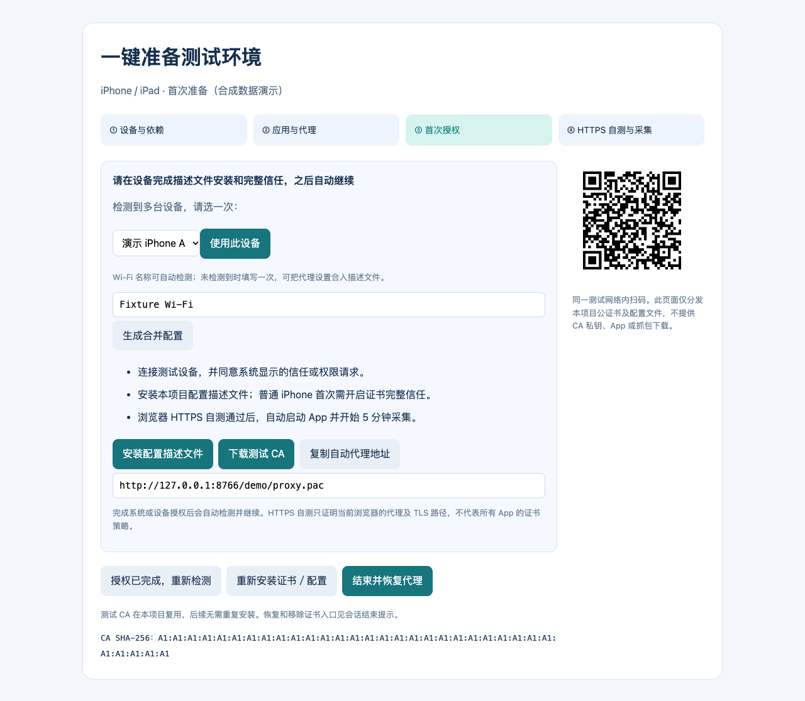
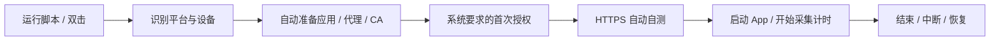

# 一键准备：macOS / iOS / Android

[项目首页](../README.md) · [移动端工具](../apk_tools/README.md) · [iOS/原生层](ios-native-guide.md) · [验收记录](apk-mcp-verification.md)

一条命令启动本地引导页，自动准备依赖、应用、代理与项目 CA。首次只按页面完成系统/设备要求的确认；后续复用 CA 与已验证设备。HTTPS 自测通过后才启动目标 App、开始计时，结束后执行本轮恢复。

## 直接使用

在仓库根目录运行：

```bash
# Android：自动识别APK、唯一设备；需要时自动准备platform-tools
./capture-setup.sh ./demo.apk --isolated-device

# iPhone/iPad：有效签名IPA；同一测试网络，优先使用Apple官方USB工具
./capture-setup.sh ./demo.ipa --target ios --isolated-device

# iOS Simulator：完整Xcode、可安装的Simulator.app
./capture-setup.sh /path/to/Demo.app --target ios-simulator --isolated-device

# macOS：配置当前网络服务及用户级测试CA，按需启动本地.app
./capture-setup.sh /path/to/Demo.app --target macos --scope scope.local.yaml
```

macOS 也可双击仓库根的 **`capture-setup.command`**，选择平台和可选安装包。取消文件选择表示只准备环境，使用已有 App。CLI 中省略应用文件也可只准备环境，`--bundle-id` 指定已有 App。

首次将依赖装到本项目 `.capture-setup/venv`。已有 Python ≥3.12 可直接使用；缺 Python 或 Android platform-tools 且已有 Homebrew 时自动安装。没有可用 Python/Homebrew 时会给出明确前置要求，不运行未知安装器。完整 Xcode、Apple Configurator 及应用签名按系统要求准备；脚本不重签、抹除或监督设备。

`--isolated-device` 仅在确实使用专用隔离测试会话时填写。未声明时观察记为 unattributed，不升级 APK/iOS 候选。环境准备与浏览器自测本身仍可使用。

## 只处理当前一步





引导页提供设备选择、手机二维码、公开 CA/描述文件下载、代理地址复制、Wi-Fi 名称合并配置、重新检测、重新安装证书/配置、结束并恢复。所有资源由本机提供；页面不提供 CA 私钥、App 文件或抓包下载。

- 多台设备时在页面选一次，避免执行到另一台设备。
- Android USB 使用本轮 reverse 与代理前置引导页，通常无需同一 Wi-Fi 或另建网页隧道。
- iOS 会尝试读取 Mac 当前 Wi-Fi 名称；读取不到时可在页面填一次，生成包含 Wi-Fi PAC 的合并描述文件。Wi-Fi 密码只在设备系统界面输入。
- 证书或代理自测不通过，可点“重新安装证书／配置”。旧会话先恢复，再以新事务重试；无需回终端重输整条命令。准备失败时页面保留供“重试准备”，期间已执行本轮代理恢复。
- 首次授权等待时间不计入采集时长。只有本轮 HTTPS 自测通过才启动 App、写设备复用记录并开始倒计时。

## 平台差异

| 平台 | 自动处理 | 首次可能需要确认 |
| --- | --- | --- |
| macOS | 选择活动网络服务、用户级 CA、HTTP/HTTPS 代理、请求启动 `.app`、恢复快照 | 证书信任及管理员 ACL 弹窗 |
| Android / 模拟器 | 唯一设备识别、APK 安装、代理、USB reverse、公证书交接、引导页、延迟启动与恢复 | USB 调试授权、系统 CA 安装确认 |
| iPhone / iPad | 可用时通过 cfgutil/devicectl 配对及安装；生成稳定 CA/PAC 描述文件、打开引导、签名校验、延迟启动 | 信任电脑、设备安装/开发者授权；无 Configurator 时还需描述文件安装与完整信任 |
| iOS Simulator | 选择/启动 Simulator、安装 `.app`、导入项目 CA、打开 Safari 引导；组合 macOS 代理快照 | 系统要求的授权与本轮 HTTPS 自测 |

Apple Configurator 的 `cfgutil` 可自动安装描述文件；脚本先检查本机工具能力和精确设备标识，支持时优先使用。首次可在 [Apple Configurator](https://apps.apple.com/app/apple-configurator/id1037126344?mt=12) 安装 Automation Tools，后续复用。脚本不自动准备监督状态。[Apple 自动化说明](https://support.apple.com/guide/deployment/configure-devices-dep6f70f6647/1/web/1.0)

普通 iPhone 手动下载的证书描述文件仍需要在设置中安装并开启 SSL 完整信任，无法把这两项系统要求伪装为已自动完成；引导页给出当前步骤，完成后自动继续。Configurator 安装证书可缩短这一过程。[Apple 证书信任说明](https://support.apple.com/en-us/102390)

HTTPS 自测证明的是**选定浏览器经过本项目代理完成真实 TLS**。应用自有信任库、pinning 或 Android 的 Network Security Configuration 仍决定其流量是否可见；浏览器成功不等于所有 App 都接受用户 CA。[Android 官方说明](https://developer.android.com/privacy-and-security/security-config)

## 常用参数

```bash
# 只检查，不生成状态或更改代理/CA/应用
./capture-setup.sh --target ios --dry-run

# 已有会话材料与范围
./capture-setup.sh ./demo.apk --inventory output-mobile/demo \
  --scope scope.local.yaml --device emulator-5554 --duration 5m --isolated-device

# 指定Mac网络服务；遇现有PAC/SOCKS/认证代理时选择专用服务
./capture-setup.sh --target macos --service 'Wi-Fi' --duration 5m

# iOS无法自动读取SSID时，可直接指定；无需提供Wi-Fi密码
./capture-setup.sh ./demo.ipa --target ios --wifi-ssid 'Test Wi-Fi' \
  --proxy-host 192.0.2.10 --isolated-device

# 192.0.2.10是文档占位，请替换为测试机真实可达LAN地址。
# 已受监督且适用的设备才显式选择全局代理配置
./capture-setup.sh --target ios --supervised --proxy-host 192.0.2.10
```

`--setup-timeout` 默认 15m，`--duration` 默认 5m。默认本机端口为代理 8080、引导页 8766；代理被占用时尝试附近空闲端口，配置与页面会使用实际端口。`--portal-port` 更改手机引导/PAC 地址，需更新对应描述文件。`--reinstall-ca` 可强制重新请求项目证书/配置，`--no-open` 用于自动化环境。

Mac 的现有 PAC、SOCKS 或需认证代理不自动接管，页面会说明冲突。需要使用专用网络服务，避免丢失无法恢复的配置。

## 退出与恢复

正常到时、页面“结束”、Ctrl+C、SIGTERM 都执行本轮恢复。代理/reverse 操作前有磁盘 intent，丢失 ACK 或进程突发中断后可从 checkpoint 恢复；下一次启动先恢复上次未清理完的会话。全用户会话锁避免两个 checkout 同时接管系统代理。PID、创建时间、命令及用户身份共同校验本轮子进程所有权。

只恢复仍为本轮值的设置，保留用户并发修改。默认保留项目测试 CA 以减少重复授权。

- macOS/Android 恢复原代理；Android 只回收本轮 reverse 和临时公证书文件。
- 普通 iOS 保留项目 CA/描述文件；结束时 PAC 切为 `DIRECT`，服务不可达时按配置允许直连回退。它不等于原始 Wi-Fi 配置字段被还原。需要完整移除时，按精确项目 profile ID 操作。[Apple Wi-Fi PAC 字段](https://developer.apple.com/documentation/devicemanagement/wifi)
- iOS/Simulator 的单证书移除如无公开工具支持，会给出对应指纹和设置入口，不重置整个 keychain。

每次结束都会打印可复制的恢复命令：

```bash
./capture-setup.sh --cleanup .capture-setup/latest.json
./capture-setup.sh --cleanup .capture-setup/latest.json --remove-ca
```

恢复路径复用已有 Python 环境，优先恢复网络后才更新依赖；可恢复会话不依赖临时代理仍然在线。证书撤销只针对本项目所有权记录及精确指纹/profile ID。

## 产物与测试

`.capture-setup/` 是私有本地目录，已被 Git 忽略，包含 CA 私钥、设备状态、引导 token、依赖环境、会话 receipt、脱敏事件及库存。文件/目录使用受限权限；不要将整个目录当作清单交给客户端。

提供 APK/iOS 文件时，提取、捕获和派生验证沿用现有清单契约；结果可从会话 JSON 的 inventory/verification 信息定位，再按 [MCP 网关指南](../gateway/README.md) 绑定来源。

验收包含真实本机 mitmdump、HTTPS CONNECT/TLS、自签项目 CA 校验、前置引导转发、两轮 CA 复用、错误明文 HTTPS 不形成 proof。平台设置/ACL/真机操作测试使用有状态 runner，**未在开发宿主安装信任、修改代理或操作真实设备**；不能将这些测试当作每个系统版本已实机验收。具体计数见 [验收记录](apk-mcp-verification.md)。
