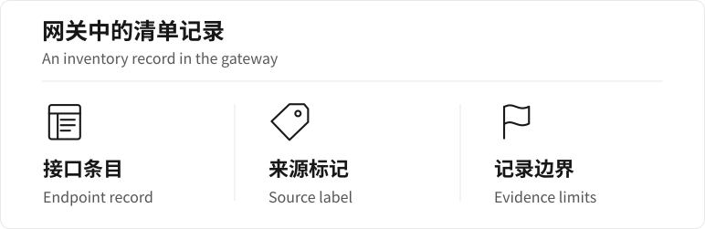

# 接口清单 MCP 网关

网关让 MCP 客户端查看来自不同应用或会话的接口清单。方法、路径和来源要一起读：同一个名字不一定指向同一个观测。

先对照[接口条目定义](../apk_tools/schemas/endpoint-record.schema.json)和[来源定义](../apk_tools/schemas/source.schema.json)。凭据独立于可分享的清单；导入一份清单也不会为条目补上运行证据。

[返回项目首页](../README.md)
